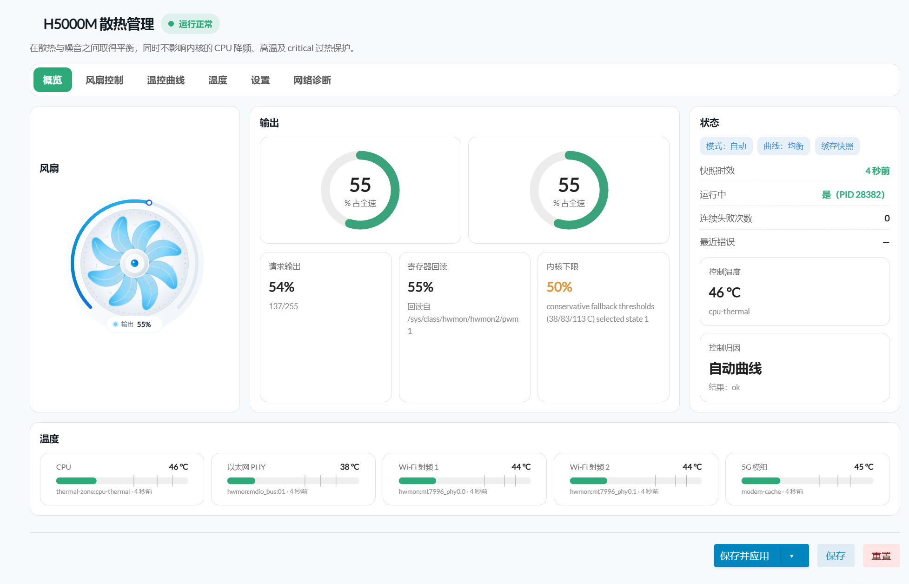

<div align="center">

# 🌀 H5000M Fan Control (v3.2.0)

**面向 Hiveton H5000M 5G CPE 的高性能原生 Rust 智能风扇温控管理系统**

[](CHANGELOG.md)
[](https://github.com/LianXia233/luci-app-h5000m-fancontrol/actions/workflows/ci.yml)
[](https://github.com/LianXia233/luci-app-h5000m-fancontrol/actions/workflows/release.yml)
[](#-运行环境与硬件兼容性)
[-DEA584?style=flat-square&logo=rust&logoColor=white)](src/)
[](LICENSE)

<p align="center">
  <b>原生零依赖 Rust 守护引擎 · 12 路 5G 模组结温本地 RPC 融合 · 拟物渐变矢量 SVG 涡轮仪表盘</b><br>
  多传感器融合控温 · 4 档智能风扇曲线 · 启停助推 · 温度滞回与降速防抖 · 完整保留 Linux 内核热安全保护
</p>

</div>

---

## 📸 界面预览

<div align="center">
  
  <p><sub>图 1：H5000M 散热控制台概览（展示拟物涡轮风扇、270° 进度环、实时寄存器回读与 5G 模组多温区融合条带）</sub></p>
</div>

- **拟物渐变动态 SVG**：8 叶拟物涡轮、随转速平滑变速的动效转子、270° 环形刻度槽及支持 `prefers-reduced-motion` 的自适应渲染；
- **原生未保存更改流程**：完全对接 LuCI 标准 UCI 暂存与回滚保护机制，移除多余的私有保存按钮；
- **控制归因与真实回读**：明确区分「目标请求 PWM」与「硬件寄存器实测回读」，无转速计（tach）反馈时不伪造 RPM 数字。

---

## 🌟 核心特性亮点

| 特性维度 | 说明与设计规范 |
|:---|:---|
| ⚡ **零依赖 Rust 守护引擎** | `/usr/sbin/h5000m-fancontrol` 采用纯静态 aarch64-musl 编译，零外部 crates.io 运行时依赖；procd 前台常驻守护，配置变更通过 `SIGHUP` 信号毫秒级热重载，避免风扇停转颠簸。 |
| 🌡️ **多传感器精准融合** | 统一采集 CPU SoC 核心、以太网 PHY、Wi-Fi 射频芯片及通过 `luci-app-mt5700` 管理器 RPC 桥接的 **5G 模组 12 路芯片结温最高值**；不可读或超时传感器判定为 `null`，绝不武断折算为 0℃。 |
| 🛡️ **坚守内核热安全红线** | 绝不将 CPU thermal zone 强制切换为 `user_space` 策略；完整保留 Linux 内核的硬件级 CPU 降频、hot 与 critical 临界过热关机熔断保护，风扇控制器仅接管 cooling-maps。 |
| 🌀 **4 档调速曲线与滞回防抖** | 内置**静音**、**均衡**、**性能**与**自定义**（线性插值）调速曲线；支持起转脉冲助推（Start Boost）、温度滞回（Hysteresis）与降速延时，彻底消灭转速频繁来回跳变的扰人噪音。 |
| 🎛️ **6 大现代化 LuCI 控制台** | 包含 **总览**、**风扇控制**、**曲线设定**、**温度监控**、**系统设置** 与 **诊断日志**；TAB 切换状态在浏览器端自动记忆持久化。 |
| 📋 **结构化状态契约** | `h5000m-fancontrol status json` 提供严格的只读快照输出，具备 JSON 字段契约规范；向后兼容 2.x 的 `key=value` 输出。 |

---

## 🚀 快速安装与使用

### 1. 运行环境与硬件兼容性

- **目标机型**：Hiveton H5000M 5G CPE（联发科 Filogic MT7987A，ARMv8 64-bit，musl）；
- **系统固件**：OpenWrt SNAPSHOT / 25.12+ 或 ImmortalWrt（需 JavaScript LuCI 支持）；
- **内核驱动**：`pwm-fan` 驱动及 `/sys/class/hwmon/*/pwm1` 硬件接口。

### 2. 使用预编译包安装 (Releases)

前往 [GitHub Releases](https://github.com/LianXia233/luci-app-h5000m-fancontrol/releases) 下载对应版本的 `.apk` 包及签名校验文件：

```sh
# 1. 校验安装包完整性
sha256sum -c SHA256SUMS --ignore-missing

# 2. 导入构建签名公钥至系统密钥库
cp openwrt-sdk-build.pem /etc/apk/keys/h5000m-build.pem

# 3. 安装主包与中文语言包
apk add luci-app-h5000m-fancontrol-3.2.0-r1.apk luci-i18n-h5000m-fancontrol-zh-cn-*.apk
```

> [!TIP]
> 临时安装亦可使用 `apk add --allow-untrusted ./luci-app-h5000m-fancontrol-*.apk`。官方 Release 包在构建时均经过 `apk adbsign` 严格签名并附带公开校验公钥。

### 3. 集成到 OpenWrt 固件源码编译

在 OpenWrt 源码根目录下克隆并勾选：

```sh
# 克隆仓库至 package 目录
git clone https://github.com/LianXia233/luci-app-h5000m-fancontrol.git package/luci-app-h5000m-fancontrol

# 配置菜单
make menuconfig
# 进入: LuCI -> Applications -> luci-app-h5000m-fancontrol (勾选)

# 单独编译验证
make package/luci-app-h5000m-fancontrol/compile V=s
```

> **注意**：源码构建需要宿主安装 Rust 工具链并具备 `aarch64-unknown-linux-musl` target；编译脚本会自动校验产物 ELF 架构，杜绝误打包宿主机二进制。

### 4. 从 2.x 升级说明

直接覆盖安装新版安装包并重启服务即可。系统内置的 `/etc/uci-defaults/91-h5000m-fancontrol-v3` 会自动将历史 2.x 配置无损迁移至 `schema_version 3`，保留既有曲线与温控阈值，非法值自动修复为安全出厂值。

---

## ⚙️ 独占风扇策略内核补丁 (可选)

H5000M 原厂设备树中的主动散热映射可能与用户空间调速控制器争抢 PWM 写入节点。若希望让 Rust 曲线 100% 独占接管风扇输出，可在编译固件前应用仓库提供的设备树补丁：

```sh
git apply package/luci-app-h5000m-fancontrol/openwrt-patches/h5000m-userspace-fan-control.patch
```

> [!IMPORTANT]
> **补丁安全边界**：
> 该补丁**仅移除设备树中风扇的 3 档 cooling-map**，CPU 核心硬件级降频阈值、Hot 与 Critical 致命过热熔断保护**全部原样保留**。不打补丁时插件亦可安全运行，但内核 thermal governor 可能会基于自身判定强制抬高实际 PWM。

---

## 🛠️ CLI 命令行操作参考

守护进程提供丰富的诊断与调试指令集：

```sh
h5000m-fancontrol status          # 输出传统 key=value 诊断文本
h5000m-fancontrol status json     # 输出标准化结构化状态快照 (秒开，不重采样)
h5000m-fancontrol status live     # 强制下发所有传感器重新采样并输出
h5000m-fancontrol apply           # 手动触发立即执行一个控制判定周期
h5000m-fancontrol validate        # 校验 UCI 配置文件语法合法性 (不操作硬件)
h5000m-fancontrol events 50       # 检索并打印最近 50 条温控调速事件日志
h5000m-fancontrol schema          # 导出 JSON 状态字段结构契约规范
h5000m-fancontrol release         # 释放硬件控制并恢复内核默认 thermal policy
```

- **UCI 配置文件**：`/etc/config/h5000m_fancontrol`（详细定义见 [docs/uci.md](docs/uci.md)）
- **系统服务管理**：`/etc/init.d/h5000m-fancontrol {start|stop|restart|reload}`
- **LuCI 界面入口**：侧边栏 **系统** → **风扇控制**

---

## 📚 项目技术文档库

- 📐 **[系统架构设计 (docs/architecture.md)](docs/architecture.md)** — 模块解耦、并发保护、数据流与生命周期管理
- 🔄 **[功能等价性映射 (docs/refactor-mapping.md)](docs/refactor-mapping.md)** — 2.1.1 Shell 脚本到 3.0.0 Rust 重构对比
- 🔌 **[状态接口契约 (docs/status-api.md)](docs/status-api.md)** — JSON 字段表规范与缺失降级定义
- 🛡️ **[热安全设计哲学 (docs/safety.md)](docs/safety.md)** — 安全不变式、下限防线与内核降频协同
- ⚙️ **[UCI 配置手册 (docs/uci.md)](docs/uci.md)** — 参数项取值范围、默认值与迁移规则
- 🏗️ **[构建与打包流水线 (docs/build.md)](docs/build.md)** — musl 交叉编译、SDK 签名与发版机制
- 🧪 **[测试验证报告 (docs/testing.md)](docs/testing.md)** — 单元测试、回归验证与实机测试记录
- ❓ **[常见故障排错 (docs/troubleshooting.md)](docs/troubleshooting.md)**

---

## 💖 致敬与鸣谢

* 👤 **[FAN789](https://github.com/FAN789)** — H5000M 原版 Shell 风扇温控插件（v2.x）的最初奠基者
* 👤 **[LianXia233](https://github.com/LianXia233)** — 主导完成 v3.x 原生 Rust 控制器重写、SVG 拟物设计与 5G 模组温度融合
* 🐧 **[ImmortalWrt](https://github.com/immortalwrt/immortalwrt)** — 优秀的 Filogic 硬件底层支持与 SDK 架构

---

> 📜 **开源许可**：本项目基于 [Apache License 2.0](LICENSE) 协议发布。
